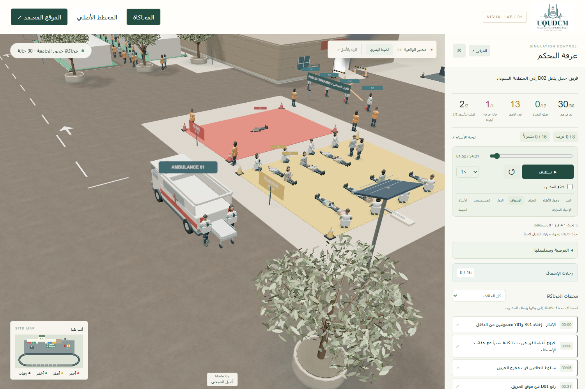

# UQUDCM-Simulation

## مختبر تحسين الواقعية

نسخة محلية مستقلة مطابقة للنسخة المنشورة رقم 15، أُعدت في 28 أكتوبر 2026.

**الحالة:** تجربة بصرية أولى جاهزة محلياً: خامات PBR للأسفلت والخرسانة والخشب، إضاءة HDR، أشجار بأوراق منفصلة، نسب بشرية أفضل وتفاصيل إضافية للمركبات، مع لوحة ضبط ومقارنة بالنسخة الأساسية.

## ما تحتويه النسخة

المبنى والغرف الثماني والأسرّة الـ16، توزيع المشاركين، سيناريو الحريق والفرز، حركة الإسعافات والطابور في الجهة المقابلة، التشغيل والإيقاف والخط الزمني، لوحة الأسرّة، الصور المرجعية، الشعار والتوقيع.

## العزل عن الموقع الحالي

- مستودع المصدر: [a9eelalsubhi/UQUDCM-Simulation](https://github.com/a9eelalsubhi/UQUDCM-Simulation).
- لا يوجد اتصال نشر تلقائي بالموقع المعتمد.
- ملف الاستضافة لا يحتوي معرّف الموقع الأصلي.
- لم تُعدّل ملفات الموقع الأصلي أو رابط نشره.
- يوثّق baseline.json بصمات ملفات النسخة الأساسية للمقارنة لاحقاً.

## التشغيل عند اختيار التجارب المحلية

افتح هذا المجلد وشغّل **Start-Lab.cmd** بالنقر المزدوج. يفتح المختبر في المتصفح تلقائياً على http://127.0.0.1:8877/ . اترك نافذة التشغيل مفتوحة أثناء الاستكشاف، وأوقفها بـ Ctrl+C. الخادم محلي على هذا الجهاز؛ ليس رابط مشاركة أونلاين.

## التشغيل من نسخة GitHub

المطلوب Python 3 ومتصفح يدعم WebGL. لا يتطلب التشغيل Node.js أو تثبيت حزم إضافية، وجميع خامات العرض وملفات المحاكاة مضمنة محلياً.

```sh
git clone https://github.com/a9eelalsubhi/UQUDCM-Simulation.git
cd UQUDCM-Simulation
python start-lab.py
```

على macOS وLinux استخدم `python3 start-lab.py`. على Windows يمكن النقر المزدوج على `Start-Lab.cmd`.



## المراجعة والمقارنة

استخدم زر «الضبط البصري» لاختيار الإضاءة والسطوع ولقطات المراجعة. زر «قارن بالأصل» يوقف المحاكاة ويفتح النسخة الأساسية من زاوية الكاميرا نفسها في تبويب آخر. زر «الموقع المعتمد» يفتح الموقع المنشور الذي لم يتغير.

هذه أول تجربة، وليست نسخة فوتوغرافية نهائية. نماذج الأشخاص ما زالت إجرائية؛ استبدالها بأصول بشرية واقعية ذات حركات مناسبة هو التحسين الأكبر التالي. لا توجد قياسات أداء على بطاقة رسومية فعلية بعد؛ خيار الجودة الخفيفة موجود للأجهزة الأضعف.

## مسار التحسين التالي

1. خامات واقعية للأرضيات والأسفلت والخرسانة والمعادن والزجاج، مع ضبط المقياس واللمعان والخشونة.
2. استبدال النماذج الهندسية المبسطة للأشخاص والأجهزة والمركبات بأصول ثلاثية الأبعاد أدق، مع توثيق تراخيص استخدامها.
3. تحسين الإضاءة والظلال وأثر الدخان والعمق، مع الحفاظ على وضوح الموقع.
4. تحسين واجهة الجولة والكاميرا والتحكم على الكمبيوتر والجوال.
5. مقارنة بصرية مع النسخة الأساسية وفحص بقاء مسارات الحركة وأعداد الحالات والداشبورد صحيحة.

لا يُستبدل الموقع الحالي بنتائج التجربة تلقائياً.
